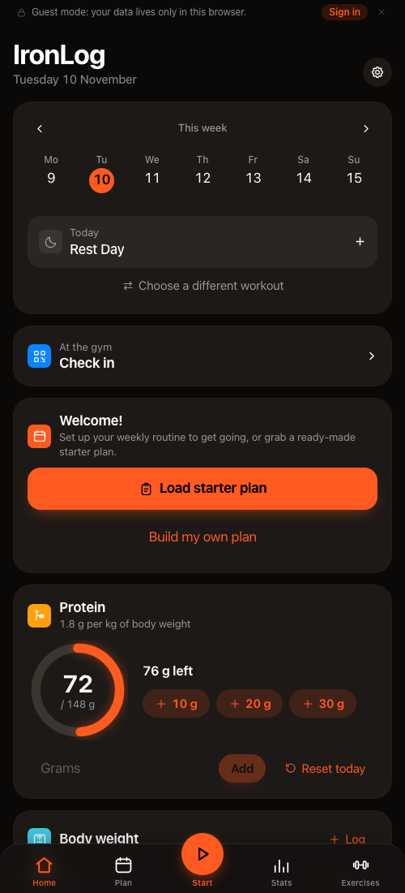

<div align="center">

# IronLog

**A self-hosted gym, body-weight and protein tracker.** Plan routines, log sessions, follow your weight
curve, and see today's protein against a goal worked out from your own body weight.



</div>

IronLog is a fork of [**openGym**](https://github.com/DuarteSantos8/openGym) by Duarte Santos
(AGPL-3.0-or-later). The training engine, exercise library, sync and passkey login come from
openGym and are the work of its author; this repository adds the parts listed below. Both projects
are licensed under the AGPL, see [LICENSE](LICENSE) and [NOTICE.md](NOTICE.md).

## What this fork adds

- **Protein tracking.** The card recommends **1.8 to 2 g per kg** of your latest weigh-in (lb profiles are
  converted) and the goal is yours to set: pick a preset, type a number, or leave it on Auto (the low end).
  A ring on Home fills as you log grams: quick adds, any amount, reset for the day.
  The log is one stamped entry per day, so it merges across devices like the rest of the profile
  (`frontend/src/lib/protein.js`, `components/MacroCard.jsx`, `api/sync-stamps.js`).
- **Protein reminders.** Three pushes a day (09:00, 13:00, 19:00 on the user's own clock), each sent only
  while the day's goal is still short, naming the grams to go in the user's language. Switch under
  Settings, Reminders (`api/protein.js`, `proteinTick` in `api/server.js`, unit tests and a
  fake-clock server test).
- **Maintenance calories, with an honest gauge.** From sex, age, height and weight (and a body-fat percentage if you have
  one) Home estimates how many calories you burn a day, as a band on a gauge. Level 1 is the formula (Mifflin-St Jeor, or
  Katch-McArdle from lean mass). Level 2 calibrates it from your own log of calories and weigh-ins over the last 28 days,
  weighting each source by how noisy it is, so the band narrows as the log gets steadier and never gets wider than the
  formula's. Level 3 (steps and heart rate from a watch) needs the phone apps and is shown as locked. A calorie target for
  lose, maintain or gain, or your own number, and a daily calorie log sit under it (`frontend/src/lib/metabolism.js`,
  `components/EnergyCard.jsx`). An estimate for reference, not medical advice.
- **Daily workout check.** One push at 20:30 on a day with no workout logged, planned or not. It skips
  noted days (sick, away), yields to the missed-workout nudge, and stops after 3 days in a row without a
  workout (`api/workout-check.js`, `workoutCheckTick`, tested with a fake clock).
- **A finer muscle explorer.** Exercises, By muscle: pick Male or Female, point at the body and the part under
  the pointer lights up in the accent. Shoulders are split into front, side and rear, the chest into upper and
  lower, the abs, quads and traps likewise, plus rhomboids and the rotator cuff; a tap lists that part's
  exercises. Where the catalogue itself names the part that is used, otherwise the exercise name decides, and a
  part it cannot tell apart says so and shows the whole muscle (`lib/muscle-regions.js`, `components/BodyMap.jsx`).
- **A new identity.** Name, logo and app icons (an open progress ring around an I-beam), an ember
  accent with a warm charcoal theme, rounder cards and pill buttons, a rounded tab bar, a card grid for exercises by default, restyled Plan and Stats.
- **Share links that stay on your own server.** A routine link opens this app
  (`<origin>/#/r/...`) instead of the original project's website.
- **Cleaned of the original project's operations:** donation and store-rating rows, release
  mirroring, CLA bot and publishing workflows are removed.
- New tests for the goal maths, log rules, the card, and both reminder schedules, translations of every new string in 18 languages.

## Run it

```bash
cp .env.example .env
docker compose up -d --build        # api + web on http://localhost:8080
```

Or for development (Node 22):

```bash
cd api && npm ci && DATA_DIR=../data RP_ID=localhost ORIGIN=http://localhost:5173 node server.js
cd frontend && npm ci && npm run dev
```

Tests: `cd frontend && npm test` and `cd api && npm test`.

## Stack

React 19 + Vite + Zustand on the front, a small `node:http` API with JSON files on disk, WebAuthn
passkeys, installable PWA. More in [docs/ARCHITECTURE.md](docs/ARCHITECTURE.md). The original
project's README, with its full feature tour, is kept at [docs/UPSTREAM_README.md](docs/UPSTREAM_README.md).

## Credits and licences

- Code: openGym © Duarte Santos, AGPL-3.0-or-later. Changes in this fork under the same licence.
- Exercise stills and animations © Aliaksandr Makatserchyk, [Gym visual](https://gymvisual.com/),
  licensed to openGym and **not** covered by the AGPL. Only the unmodified 180 px files are
  included, for non-commercial use, with the notice in [NOTICE.md](NOTICE.md). Any other use needs
  your own licence from Gym visual.
- Third-party components are listed in [NOTICE.md](NOTICE.md).
